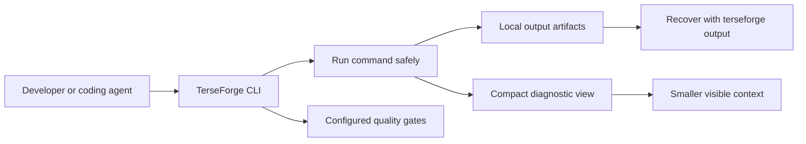

<p align="center">
  
</p>

<h1 align="center">TerseForge</h1>

<p align="center">
  <strong>Big code. Small chatter.</strong><br>
  Local, measurable context and tool-output optimization for AI coding agents.
</p>

<p align="center">
  <a href="https://github.com/luucabg/terseforge/actions/workflows/ci.yml"></a>
  <a href="https://www.npmjs.com/package/terseforge"></a>
  <a href="https://github.com/luucabg/terseforge/releases/tag/v0.2.0"></a>
  
  <a href="LICENSE"></a>
  
</p>

<p align="center">
  <a href="#quick-start">Quick start</a> ·
  <a href="#how-it-works">How it works</a> ·
  <a href="#compatibility">Compatibility</a> ·
  <a href="#measured-component-benchmark">Benchmark</a> ·
  <a href="#documentation">Documentation</a>
</p>

---

TerseForge helps coding agents spend less of their context window on terminal noise and broad file reads. It keeps full logs local, surfaces the lines that matter, selects TypeScript and JavaScript context progressively, and runs the checks you choose.

It does not replace your agent, call a model, or send your code anywhere.

Install the Agent Skill once. Then ask your coding agent:

> **Activate TerseForge in this project.**

> [!IMPORTANT]
> TerseForge reduces context and visible output. It does not lower the quality bar. Errors, warnings, paths, line numbers, commands, diffs, and security findings stay protected. Required quality gates must pass before work is considered verified.

## Keep the signal. Drop the noise.

A long test run may contain hundreds of routine lines and only a few useful diagnostics. Sending everything wastes context. Blind truncation is worse: it can hide the line that explains the failure.

TerseForge makes reduction reversible:

| Problem | What TerseForge does |
| --- | --- |
| Large terminal logs consume context | Shows a compact diagnostic view and stores the complete output locally. |
| An omitted line becomes important later | Recovers stored bytes, original line endings, or the exact stdout/stderr stream. |
| The agent reads whole files too early | Reuses an incremental TS/JS index, ranks related files, and emits multiple snippets within a budget. |
| Token savings tempt agents to skip checks | Detects explicit project scripts and fails closed when required verification is absent. |
| Integration claims are vague | Labels each agent as native-limited, instructions-only, or experimental. |
| You do not want to upload code or logs | Keeps state local under `.terseforge/` and sends no remote telemetry. |

The rule is simple: compact what the agent sees, but keep the source available.

## Quick start

### Ask your coding agent to install it

TerseForge is an Agent Skill plus a local CLI, not a universal plugin. To install it from [luucabg/terseforge](https://github.com/luucabg/terseforge), paste this into Codex, Claude Code, or Gemini CLI:

```text
Install the `terseforge` package from npm for the coding agent I am using.
Use https://github.com/luucabg/terseforge as the canonical project and documentation source.
Run `npm install --global terseforge` to make the CLI available.
Install both the local CLI and the user-scoped Agent Skill for the current agent.
Make `terseforge` available in future terminal sessions.
Preserve existing configuration and agent files.
Do not publish anything or activate TerseForge in the current project yet.
Verify the installation with `terseforge --version` and `terseforge skill status --agent <current-agent> --scope user`.
```

### Install it yourself

Install the public package with npm:

```bash
npm install --global terseforge
terseforge --version
```

The package page is [npmjs.com/package/terseforge](https://www.npmjs.com/package/terseforge). Contributors can still build from source using the steps in [CONTRIBUTING.md](CONTRIBUTING.md).

Install the native Agent Skill once for the agent you use:

```bash
terseforge skill install --agent codex
# or: terseforge skill install --agent claude
# or: terseforge skill install --agent gemini
```

### Activate it in a project

Start a new agent session, open a repository, and ask:

```text
Activate TerseForge in this project.
```

If the project has no configuration, the skill starts with the conservative `safe` preset. It also installs a project-scoped copy for future sessions and runs `terseforge doctor`. Ask for another preset when you want one, for example: `Use TerseForge lean in this project.`

Prefer explicit setup? `safe` is still the default:

```bash
cd /path/to/your/repository
terseforge init --preset safe --install codex claude
terseforge doctor
```

Then use the compact workflow:

```bash
terseforge map
terseforge context "refresh token validation" --symbol validateToken --budget 800
terseforge exec -- npm test
terseforge check
```

If compact output omits something you need, recover it byte for byte:

```bash
terseforge output <run-id>
terseforge output <run-id> --lines 100:180
terseforge output <run-id> --stream stderr
```

`init` never overwrites an existing agent instruction file. It installs only the integrations explicitly named with `--install` and keeps reference copies under `.terseforge/integrations/`.

## How it works



The CLI uses executable-and-argument arrays rather than a user-controlled shell expression. Successful process launches store stdout and stderr byte for byte, plus a merged best-effort view and a sequenced event log. `terseforge output` writes stored bytes directly to stdout without adding a newline or decoding the content. The merged view preserves observed chunk arrival order, but it is not presented as an exact reconstruction of terminal interleaving.

Context selection follows a separate progressive path:

```text
tracked and untracked files → incremental TS/JS index → dependency expansion → ranked snippets → token estimate
```

See the [architecture](docs/architecture.md) for module and failure-policy details.

The installer preserves files it does not own. Read [Agent Skill setup](docs/skills.md) for discovery paths, direct invocation, updates, and removal.

## CLI commands

| Command | Purpose |
| --- | --- |
| `terseforge init` | Conservative configuration plus optional agent instruction files. |
| `terseforge mode <safe\|lean\|ultra>` | Change only the current preset without resetting configuration. |
| `terseforge skill install\|status` | Install or inspect the natural-language Agent Skill. |
| `terseforge doctor` | Runtime, configuration, and integration diagnostics. |
| `terseforge exec -- <command> [args...]` | Compact visible output with a complete local artifact. |
| `terseforge output <run-id> [--lines 20:60] [--stream stdout]` | Byte-preserving recovery of merged or source-stream output. |
| `terseforge map [--json] [--max-files 500]` | A bounded TS/JS map of imports and top-level symbols. |
| `terseforge context "query" [--symbol name]` | Ranked, numbered snippets within a configurable budget. |
| `terseforge check` | Configured gates; required failures return a non-zero exit code. |
| `terseforge handoff "objective"` | A deterministic local session handoff. |
| `terseforge stats [--json]` | Local execution and visible-byte metrics. |
| `terseforge clean [--dry-run] [--older-than days]` | Preview or remove expired local artifacts and metric records. |
| `terseforge bench [--json]` | The reproducible pruning-and-recovery benchmark. |

Visible-byte statistics include the recovery instruction itself. Very short outputs can therefore report negative savings; TerseForge exposes that overhead instead of hiding it.

## Presets

| Preset | Routine head / tail | Duplicate diagnostics | Best fit |
| --- | ---: | --- | --- |
| **`safe`** | 60 / 60 lines | Preserved | New repositories, risky changes, and debugging. **Default.** |
| **`lean`** | 25 / 25 lines | Exact duplicates counted | Daily work after validating the repository. |
| **`ultra`** | 10 / 10 lines | Exact duplicates counted | Explicitly chosen low-chatter workflows. |

All presets retain diagnostic lines plus nearby multiline context such as stack frames, assertion diffs, and source excerpts. TerseForge detects direct and package-script invocations of TypeScript, ESLint, Vitest, and Jest, then falls back to a conservative generic classifier. If nearly every line is diagnostic, the compact output may remain large. Correctness wins over compression.

## Compatibility

Compatibility is based on what the integration can do, not on how many product logos fit in the README.

| Agent | v0.2 level | Available today | Not claimed |
| --- | --- | --- | --- |
| Claude Code | **Native-limited** | Native `terseforge` skill, `/terseforge`, `CLAUDE.md`, and explicit CLI workflow. | Automatic interception of every tool call. |
| Codex | **Native-limited** | Native `terseforge` skill, `$terseforge`, `AGENTS.md`, and explicit CLI workflow. | Automatic replacement of tool results. |
| Gemini CLI | **Native-limited** | Native `terseforge` Agent Skill, natural-language activation, `GEMINI.md`, and explicit CLI workflow. | Stable hook interception. |
| Other `AGENTS.md` agents | **Instructions-only** | Portable policy and CLI commands. | Runtime enforcement. |
| Cursor, Windsurf, Cline | **Instructions-only** | Persistent rule-file assets. | Automatic command routing. |

**Native-limited** means the agent natively loads an included instruction or skill format. It does not mean TerseForge transparently controls the agent. Read the complete [compatibility contract](docs/compatibility.md).

## Measured component benchmark

The included benchmark runs a deterministic five-fixture corpus shaped like generic command output, TypeScript, ESLint, Vitest, and Jest. It compresses every fixture with every preset, checks that complete known diagnostics remain visible, and verifies byte-for-byte stored-artifact recovery.

| Preset | Visible-byte reduction | Diagnostics retained | Raw output recoverable |
| --- | ---: | :---: | :---: |
| `safe` | 54.29% | Yes | Yes |
| `lean` | 76.48% | Yes | Yes |
| `ultra` | 86.10% | Yes | Yes |

Run it yourself:

```bash
npm run build
node dist/cli.js bench --json
```

> [!CAUTION]
> These numbers measure one deterministic tool-output component. They are **not** claims about total tokens, model cost, task success, or code quality. End-to-end claims require controlled A/B agent runs.

The current committed result is in [`benchmarks/baseline-v0.2.json`](benchmarks/baseline-v0.2.json). The original v0.1 baseline remains available for historical comparison. The full protocol and release criteria are in [benchmarking](docs/benchmarking.md).

## Configuration

`terseforge.config.json` is local, declarative, and safe to version:

```json
{
  "schemaVersion": 1,
  "preset": "safe",
  "telemetry": false,
  "context": {
    "budgetTokens": 1200,
    "maxFileBytes": 200000
  },
  "output": {
    "artifactRetentionDays": 30
  },
  "qualityGates": [
    {
      "name": "test",
      "command": "npm",
      "args": ["test"],
      "required": true,
      "timeoutMs": 300000
    }
  ]
}
```

Commands and arguments stay separate. Shell expressions such as `npm test && deploy` are rejected. See the [configuration reference](docs/configuration.md).

`terseforge init` detects existing `typecheck`, `lint`, `test`, and `build` package scripts and writes only those gates, without `--if-present`. It also adds one idempotent `/.terseforge/` rule to `.gitignore` so raw command output is not committed accidentally. If no gates are configured, `terseforge check` exits non-zero and records verification as not configured.

`artifactRetentionDays` is applied explicitly through `terseforge clean`. Use `--dry-run` before removal when reviewing shared or unfamiliar workspaces.

## Large repositories

`map` and `context` keep a local structural index at `.terseforge/cache/context-index-v1.json`. Unchanged files reuse cached imports, symbols, and search terms; new or changed files are parsed again, and deleted files are removed from the index. Reexports, dynamic imports, CommonJS `require` calls, relative imports, and root `tsconfig` path aliases participate in one-hop dependency expansion.

The index does not contain complete source files. Context snippets are read from the current working tree only after candidates are ranked. For very large monorepos, `--cwd <workspace>` remains useful for limiting the search boundary.

## Local by design

| Property | v0.2 behavior |
| --- | --- |
| Server | None required or included. |
| Model calls | None. TerseForge is not an LLM proxy. |
| Remote telemetry | None. The configuration only accepts `false`. |
| Stored data | Per-stream artifacts, merged output, event logs, metrics, index data, reports, and handoffs under `.terseforge/`. |
| Process execution | Argument arrays; no concatenated user-controlled shell expression. |
| Failure policy | Compression remains recoverable; required quality gates fail closed. |

Command output can contain secrets. Raw artifacts use owner-only permissions where the operating system supports them; treat `.terseforge/` as sensitive local data. Read the [privacy model](docs/privacy.md) and [security policy](SECURITY.md).

## Project status

TerseForge `v0.2.0` is an experimental, working release published on npm for Node.js 22 and 24 on Windows, macOS, and Linux. CI runs type checking, ESLint, tests with coverage thresholds, a production build, CLI smoke tests, and the component benchmark.

Deliberate v0.2 exclusions:

- no adaptive `auto` preset;
- no embeddings, vector database, or semantic model;
- no remote telemetry, server, or dashboard;
- no automatic transcript or session interception;
- no custom diff engine;
- no claim of complete support for every coding agent;
- no automatic modification of a project before explicit activation.

## Documentation

- [Architecture and failure policy](docs/architecture.md)
- [Configuration reference](docs/configuration.md)
- [Compatibility contract](docs/compatibility.md)
- [Agent Skill setup](docs/skills.md)
- [Benchmark methodology](docs/benchmarking.md)
- [Privacy model](docs/privacy.md)
- [Brand and messaging guidelines](docs/brand-guidelines.md)
- [Maintainer publishing guide](docs/publishing.md)
- [Machine-readable project summary](llms.txt)
- [Example workflow](examples/README.md)
- [Changelog](CHANGELOG.md)

## Contributing

Issues and focused pull requests are welcome. Start with [CONTRIBUTING.md](CONTRIBUTING.md), run `npm run check`, and keep performance claims tied to reproducible evidence.

TerseForge is available under the [MIT License](LICENSE).
